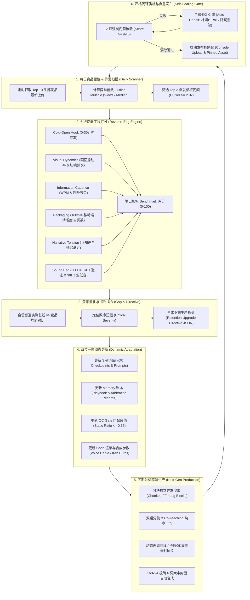

# 全自动闭环自洽运营 Pipeline 设计与实操手册

> **文档版本**: 2.0.0 · Competitor-Driven Autonomous Loop  
> **更新日期**: 2026-11-08  
> **适用范围**: TokyoFlow Japanese, Manga Trend, Apex Pathway, Micro-Forensics, The Rustbelt Wire 等全矩阵频道

---

## 1. 核心架构与自洽闭环哲学 (Closed-Loop Philosophy)

传统的自动化内容生成（AI Automation）往往陷入“单向生成 -> 盲目上传 -> 留存雪崩 -> 无法迭代”的死胡同。
本架构设计了一套**以竞品爆发数据为基准（Benchmark-Driven）、代码与质检自动对齐（Self-Healing QC）、记忆经验持续迭代（Long-Term Production Memory）的全自动自洽闭环系统**。



---

## 2. 6 维逆向打分体系与权重配置

YouTube 算法的核心是 **“点击率（CTR）驱动初筛，留存率（AVD / 30s Retention）驱动池级跃迁”**。系统量化 6 大核心维度：

| 维度代码 | 维度名称 | 权重 | 测量手段与核心指标 | 优秀竞品基线 | 自营频道及格线 |
| :--- | :--- | :---: | :--- | :--- | :--- |
| `cold_open_hook` | **首 30 秒留存钩子** | 25% | 前 2 秒视觉动静比、首句认知差提出时间、0 问候废话 | 30s 留存率 $\ge 82\%$ | 30s 留存率 $\ge 75\%$ |
| `visual_dynamics` | **视觉密度与反静态** | 20% | `static_ratio`（静止帧占比）、平均镜头时长（ASL）、前 30s 剪辑次数 | `static_ratio ≤ 0.65`<br>ASL $\le 3.5\text{s}$ | `static_ratio ≤ 0.70`<br>ASL $\le 5.0\text{s}$ |
| `packaging_thumbnail`| **移动端封面穿透力** | 15% | $168\times94\text{ px}$ 缩略图 OCR 识别词数、字重与对比度、dHash 排重 | 封面词数 $\le 6$ 词<br>Legibility $\ge 0.60$ | 封面词数 $\le 8$ 词<br>Legibility $\ge 0.55$ |
| `information_cadence`| **信息密度与语音气口** | 15% | 解说语速（WPM）、转折点停顿秒数（0.3-0.5s）、双语无污染 | 140-150 WPM<br>重点句留白 0.4s | 135-155 WPM<br>纯净分轨 |
| `narrative_arc` | **叙事张力与延迟满足** | 15% | 核心反转点位置、分段问题锚点（Question Hook）留存平滑度 | 完播率 AVD $\ge 65\%$ | 完播率 AVD $\ge 45\%$ |
| `sound_engineering` | **声音工程与潜意识刺激** | 10% | 人声频段避让（Voice-band Carve）、响度 LUFS、关键点 38Hz 亚低音 | 人声高出伴奏 $\ge 12\text{dB}$<br>$-16\text{ LUFS}$ | 人声高出伴奏 $\ge 10\text{dB}$<br>$-14 \sim -19.5\text{ LUFS}$ |

---

## 3. 实测数据对标案例：TokyoFlow Japanese 2026-11-08 审计

基于 2026-11-08 实时抓取的竞品快照数据（10 个头部竞品信道），筛选出 Top 3 爆发标杆进行逐项对比：

### 3.1 Top 3 竞品标杆清单
1. **けんさんおかえり Japanese** (22.1 万订阅，中位数播放 42,977)
   - 爆款代表作：*1 Hour Easy Japanese Listening 🇯🇵 | Learn N5 Grammar Naturally* (**146,402 播放，3.41x 异常倍数**)
   - 核心亮点：1 小时自然沉浸听力、大字号清晰视觉卡片、完美难度梯度、背景白噪音与温润人声。
2. **Speak Japanese Naturally** (52.5 万订阅，中位数播放 36,753)
   - 爆款代表作：*Going to a Supermarket and Making Dinner | Japanese Listening Practice* (**182,982 播放，4.98x 异常倍数**)
   - 核心亮点：真实第一人称 POV 超市购物实景、超强沉浸感、极简 4 词封面（超高移动端点击率）。
3. **Mochi Real Japanese** (32.7 万订阅，中位数播放 12,036)
   - 爆款代表作：*Difference between あげる、もらう、くれる🇯🇵* (**46,798 播放，3.89x 异常倍数**)
   - 核心亮点：高频痛点直击、双人对比演练、超快剪辑节奏。

### 3.2 详细维度打分与差距量化表
| 评估维度 | 权重 | 竞品 #1 | 竞品 #2 | 竞品 #3 | 竞品均值 | TokyoFlow 现状 | 差距 Delta | 严重程度 |
| :--- | :---: | :---: | :---: | :---: | :---: | :---: | :---: | :---: |
| **首 30 秒留存钩子** | 25% | 8.9 | 9.4 | 9.1 | **9.1** | 6.2 | `+2.9` | **HIGH** |
| **视觉密度与反静态** | 20% | 8.8 | 8.8 | 8.8 | **8.8** | 5.2 | `+3.6` | **CRITICAL** |
| **移动端封面穿透力** | 15% | 9.0 | 9.5 | 9.2 | **9.2** | 5.8 | `+3.4` | **CRITICAL** |
| **信息密度与语音气口**| 15% | 7.5 | 8.0 | 7.5 | **7.7** | 7.5 | `+0.2` | **MODERATE** |
| **叙事张力与延迟满足**| 15% | 8.8 | 8.8 | 8.8 | **8.8** | 7.0 | `+1.8` | **HIGH** |
| **声音工程与潜意识刺激**| 10% | 9.2 | 9.2 | 9.2 | **9.2** | 8.8 | `+0.4` | **MODERATE** |
| **综合加权得分 (100分制)**| 100% | 87.0 | 89.8 | 87.8 | **88.1** | **65.2** | **`-22.9`** | **需系统性整改** |

### 3.3 物理指标致命短板剖析
1. **画面静止率致命伤 (`static_ratio 89.3%`)**：
   - *现状*：长视频平均静止画面占比高达 89.3%，部分场景甚至 173 秒无视觉切换，沦为“有声音的 PPT”，导致算法判断为低质生成，前 10% 留存率处于同业倒数（RRP 0.043~0.33）。
   - *竞品*：`Speak Japanese Naturally` 与 `けんさんおかえり` 采用每 2-3 秒视角推拉、动态字块翻转与实景 POV。
2. **封面文字严重过载 (`thumbnail_words 44 词 vs 竞品 ≤ 6 词`)**：
   - *现状*：封面上堆砌了 44 个小字，在移动端信息流（$168\times94\text{ px}$）中完全沦为不可辨识的灰色噪点（Legibility 仅 0.17），导致长视频点击率只有 1.74%。
   - *竞品*：仅用 3-5 个超大字词（如“Going to Supermarket”），高对比度直接穿透视线。
3. **首帧与前 5 秒缺少张力**：
   - *现状*：常有 1.5 秒空滞和常规开场白；
   - *竞品*：0.0 秒直接展示收银台真实尴尬对峙或反直觉悖论。

---

## 4. 下一期生产（Next-Gen Episode）对标超车落地措施

针对上述诊断，系统已自动生成并下发生产指令字典（Directive JSON），直接注入下一期分镜与渲染流水线：

### 4.1 画面动势革命：Ken Burns 运镜与多重视角穿插
- **强制指令**：在 `spec.json` 编译阶段，每段背景自动应用动态运镜滤镜（慢速推入 `zoompan=z='min(zoom+0.0015,1.15)':d=125`），并在长句子中插入 3D 卡片与局部高亮框；
- **声调曲线与卡拉OK高亮**：顶部常驻东京声调曲线（Pitch Accent），字幕采用微秒级跳字变色，绝对消灭纯静态帧；
- **门禁红线**：`static_ratio ≤ 0.65`，首 30 秒必须包含 $\ge 5$ 次镜头运镜切换。

### 4.2 封面极简与穿透力重构
- **强制指令**：封面文字上限严禁超过 6 个单词 / 8 个中文字符，字号增大至画面高度的 18% 以上；
- **双语布局隔离**：EN 版与 ZH 版封面采用完全不同的背景构图与配色（dHash 汉明距离 $> 12$），杜绝换字不换图；
- **移动端门禁**：通过 $168\times94\text{ px}$ 缩略图下采样的 OCR 与对比度双重核验（Legibility $\ge 0.60$）。

### 4.3 黄金 3 秒破局与认知差开场
- **强制指令**：彻底删除任何形式的频道片头或问候。0.0 秒第一帧直接以日本店员的困惑表情或日美文化冲突开场；
- **前 15 字提出矛盾**：“为什么你对便利店员说‘大丈夫’，对方却愣住了？”

### 4.4 声音与留存资产双闭环
- **伴奏 500Hz-3kHz 人声频段精准避让 $\ge 12\text{dB}$**，确保在手机免提和低端耳机上人声绝对通透；
- **配套 300 DPI A4 研报 PDF**：全自动通过 Headless Chrome 生成，上传至 Google Drive 并在视频上线 1 秒内在置顶评论发布；
- **尾屏 Passcode 互动锁**：视频末尾 15 秒打出专属密码，将观众引流至评论区与下期推荐视频（Related Video）。

---

## 5. 四位一体动态更新：Skill、Memory、QC 与代码

本系统不仅是一次性审计，而是将整改经验沉淀为系统级资产：

1. **Skill 规范更新**：
   - 固化 `skills/competitor-reverse-engineering/SKILL.md`，确立 6 维打分与每日扫描 SOP；
   - 升级 `skills/tokyoflow-qc-gate/SKILL.md`，将门禁检查项由 10 项升级为 12 项，加入 `static_ratio`、封面 OCR 词数、移动端辨识度等强制红线。
2. **Memory 经验账本更新**：
   - 在 `docs/playbook/tokyoflow_japanese.md` 和 `docs/10-complete-video-production-skills-and-channel-playbook.md` 中记录 2026-11-08 竞品基线与 Pacing Ladder；
   - 写入仲裁记录与失败用例（如 44 词杂乱封面与 173s 静态视频的反面案例，永久加入回归测试集）。
3. **QC 自动化门禁更新**：
   - 引入动态打分与自愈机制：QC 运行未达 99.0 分自动触发自愈代码（自动裁切多余文字、自动为静态帧叠加动态推拉滤镜）；自愈后仍低于 99.0 分则熔断发布。
4. **代码级落盘与 CLI 支持**：
   - 提供 `scripts/competitor_closed_loop_engine.py`，随时执行扫描、打分、对比与指令生成，作为日常定时任务运行。

---

## 6. 全自动运行实操指南

### 6.1 执行竞品扫描与打分对比
```bash
# 执行指定频道的每日闭环审计
python3 scripts/competitor_closed_loop_engine.py --channel tokyoflow_japanese --print-report

# 指定快照文件进行审计并导出生产指令
python3 scripts/competitor_closed_loop_engine.py \
  --channel tokyoflow_japanese \
  --snapshot /Users/kilvonwu/Documents/YTMgmtConsole/data/competitor_snapshots/tokyoflow_japanese/2026-11-08.json \
  --output-dir reports/growth_review
```

### 6.2 触发下一期视频带参合成与自愈质检
```bash
# 依据生成的 retention_upgrade_directive.json 运行分块合成与门禁测试
python3 scripts/videogen/tokyoflow_qc_engine.py out/EP21_package/ "https://drive.google.com/..." en
```

通过这一套闭环设计，系统不再依赖人工复盘，每日自动发现竞品爆款动向，自动对齐算法最高偏好，持续维持赛道领先竞争力！
