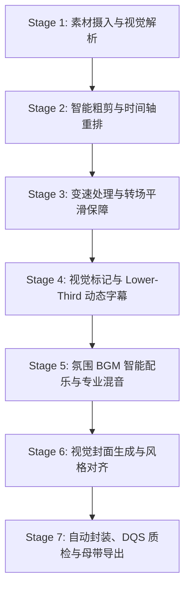

# AI Agent 智能视频剪辑与混音管线 (AI Agentic Video Editor)

将“粗糙素材输入与零碎剪辑需求”转化为“多轨精准排布、视觉打点明确、声画合一、即刻交付”的标准化工业级成片管线。

## 2026-09-30 三种生产模式与出片优先（最高优先级）

- 创始人给出题材后，只选择并完成一个明确模式：`TOPIC_LONG`（选定题材长片）、`TOPIC_SHORT`（选定题材普通 Short）或 `HOT_11S`（当天临时插播的精确 11 秒 Short）。不得自动把一个请求扩张成三种片；创始人明确要“长片＋Short”时才作为成对任务，按长片先确认、再做普通 Short。
- 题材默认以创始人当次给出的题材为准，不要求它预先存在于 active plan。只有创始人说“按计划下一条／继续计划”或没有给出具体题材时，才从 `active-ypp-plan.json` 取题。
- 优先级固定为：观众看见的成片体验 → 最快安全形成可上传成品 → 最小必要运行记录。任何不能改善故事、画面、原声、字幕、封面或上传结果的审计工作，都不得拖慢出片。
- 每个模式只交付上传或复现当前批准成片所需的素材、script、故事和发布包。自动 QC 仍运行，但明细只存在系统临时目录；不得新建审计报告、证据台账、hash 清单、阶段回执或分析文档来证明“做过工作”。
- `HOT_11S` 不因没有合成旁白而生成伪四语音轨；只有当前批准成片确实含需要本地化的旁白时，才生成粤／英／日／韩 Edge TTS 音轨。歌曲、采访和其他人物原声保留原声，用七语字幕覆盖。
- 创作证明按片长缩放：`TOPIC_LONG` 才执行 90 秒开场样片＋最难中段三分钟样片；`TOPIC_SHORT` 直接用完整 Short 作为创作证明与母版审批；`HOT_11S` 直接用完整 11 秒版本审批。不得为了满足长片样片表格而给短片制造无用中间片。
- 片源搜寻由代理负责：收到题材后主动从 YouTube、官方艺人／片商／唱片公司／电视台、节目与发行官网、公开采访／幕后、Vimeo、Internet Archive、公共领域／开放许可档案及数字发行平台公开片段页寻找可用素材。不得要求创始人代找、代下载或提供片源。YouTube 内不足时必须转向站外；仍不足时换来源、改结构、缩短／降级或写 `HOLD_SOURCE_MATERIAL_UNAVAILABLE`，不能把任务退回创始人。

## 2026-09-30 四目录精简交付（最高优先级）

- 每条长片和 Short 的正式目录只保留 `素材/`、`script/`、`故事/`、`发布包/`。其中：`素材/` 只放成片实际采用的源文件和一份 `素材清单.md`（网址／片名／时码／权利）；`script/` 放可复现生产的脚本、spec 与合同；`故事/` 放获批大纲、最终旁白和必要故事稿；`发布包/` 放最终 MP4、封面、七语 CC、四条 Edge TTS 音轨、YouTube 文案及唯一 `release-package.json`。
- 不再持久化独立 `.sha256`、逐阶段 manifest／receipt、QC／evidence 文件夹、ASR／OCR 中间件、联系表、预览、缓存、候选评分或 housekeeping 回执。详细 QC 可在系统临时目录运行，阶段结束即删；发布包只嵌入简短 `PASS/HOLD` 摘要。质量门不减少。
- 创始人确认以“不可覆盖的版本文件名＋明确回复”绑定；修改即另存新版本，禁止覆盖已确认文件。不主动向创始人展示或要求确认 hash，除非发生完整性异常或创始人明确索要。
- 工作文件只进系统临时目录，不进 asset-library。上传完成后的 housekeeping 只保留上述四目录中的最终采用内容；旧项目在各自下一次 housekeeping 时迁移，不为本规则做无差别批量删除。
- 本节覆盖下文所有要求独立 hash／manifest／QC 回执／证据目录的历史写法；历史工具可兼容读取旧包，但新项目必须写精简包。

## 所有已批准视频制作的 Edge TTS 长期授权

- 创始人已长期授权：任何已获批准制作的片子，都可以把该片完整、未公开的旁白文本发送到 Microsoft Edge TTS 的 `speech.platform.bing.com` 生成正式语音；普通话主旁白和项目要求的多语旁白都在范围内。不得再逐片、逐语言、逐段或因同一服务重试而询问外发许可。
- “已批准制作”必须有当前项目可追溯的批准证据；这项授权只消除 Edge TTS 文本外发确认，不代替选题、大纲、母版、预算、上传、发布、权利或最终审片门。未获批准制作的片子不能借用本授权。
- 只发送该片生成语音所需的旁白文本与必要语言／voice 参数，不夹带 App 私域记忆、个人资料、客户／雇主资料、账号凭据、研究原件或原始媒体。若供应商或 endpoint 不再是 `speech.platform.bing.com`，重新确认；不得静默换供应商。
- `发布包/release-package.json` 只记录长期授权 id、制作批准版本、endpoint host、语言、voice、rate 与生成状态；不保存文本或输出 hash。服务不可用写 `HOLD_LANGUAGE_SERVICE`，不得写缺外发许可，也不得回退本地 TTS。

电影／音乐人物横版长片必须同时读取并执行 [《甜蜜蜜》《新不了情》长片标杆](references/film-music-long-benchmark.md)。该标杆把文字、原声／配乐、订阅口播、四段收尾、节目预告和确定性 QC 绑定为同一份交付合同；不能只借外观而跳过声音、来源或顺序门。

## 2026-09-28 LYD1002 创作证明门（最高优先级）

先证明这条片值得完整制作，再启动完整生产。观众看不见的工业完整度，不能补救观众看得见的叙事松散、素材普通与情绪不足；国际化发行只能放大已经成立的作品。

- 音乐／电影人物项目执行 `CREATIVE_PROOF → PICTURE_LOCK → DISTRIBUTION_EXPANSION`。`TOPIC_LONG` 的 `CREATIVE_PROOF` 完成项目级 `MASTER_CONTRACT`、一句话命题、制作等级、三至五段英雄素材、90 秒开场样片、最难中段三分钟样片及样片基础 QC；两道样片均须由创始人按不可覆盖版本文件名批准。`TOPIC_SHORT` 与 `HOT_11S` 按上方缩放规则直接审批完整短母版。只有当前请求模式的中文母版版本明确获批，才进入其 `DISTRIBUTION_EXPANSION`。
- 中文母版获批前禁止七语翻译、多语言 CC、粤／英／日／韩副音轨、多语混音、完整 Short 发行包、YouTube Studio 手工资产、上传后审计和 housekeeping。普通话主旁白可按现有 Edge TTS 长期授权生成，但外发许可绝不等于发行扩张批准。
- `MASTER_CONTRACT` 在正式渲染前锁定根目录、字幕颜色／字号／安全区／轨数、原片硬字幕处理、专名与多音字、封面／章节卡、CTA、长片四段片尾、Short 品牌尾钩、翻牌尺寸／圆角／Logo、黑屏／重复／静音阈值及禁止黑底独立封面、双字幕和内部样稿字样。缺失即 `HOLD_MASTER_CONTRACT`。
- 大纲必须用一句话核心命题约束一个主要人物处境、一个主要时代矛盾和最多三个章节；每章都要说明怎样推进命题。音乐人物长片默认约 12–15 分钟；超过 15 分钟必须新增冲突、人物行动或情绪升级，只有知识增量不能加长。
- 脚本扩写前必须取得三至五段可独立支撑开场、转折、章节或结尾的英雄素材。碎片 MV、新闻短片和零散采访的数量不能替代连续人物采访、完整情绪现场、事件档案或可连续使用的歌曲／演出。英雄素材不足即缩成 6–10 分钟、改单曲解析、改 Short 或暂停，不得用旁白和章节卡遮掩。
- 音乐题材执行“原声先发生，旁白后点破”。每个核心原声窗口标记 `CHARACTER_REVEAL`、`CONFLICT`、`TURNING_POINT`、`EMOTIONAL_RELEASE` 或 `ENDING_RESOLUTION`；只证明歌名／年份／版本存在的片段不计核心价值。至少验证两至三段有完整情绪发展的连续原声，且旁白不抢先覆盖、不在原声后复述歌词。
- 中文旁白锁定前先尝试削减 20%–30%，检查连续三句以上抽象判断、每 60–90 秒是否回到人物／动作／现场、画面或原声是否已表达、是否把普通处境写成宏大口号，以及是否缺少停顿和情绪释放。删后仍成立的判断句原则上不留。
- 90 秒开场样片验证 12 秒内核心矛盾、人物身份、无独立黑底宣传封面、CTA 不打断、字幕／读音／颜色／画面合同和原声关系；三分钟样片必须取最难中段，验证无编年史速览、无重复素材依赖、旁白密度可承受、原声推动叙事和章节因果。任一失败先改大纲或降级，禁止继续堆素材。
- 黑屏／近黑帧、重复镜头、静音／异常响度、字幕流数量、烧录与外挂双字幕、OCR 内部字样、多音字、章节卡遮画、片尾与尾钩结构检查全部前移到样片阶段。项目级发音覆写必须进入 TTS、字幕和 ASR／对齐门，例如 `机车行 = jī chē háng`。基础错误必须回共享渲染源修复，禁止逐个衍生版打补丁。
- 开工前声明 `LEAN`、`STANDARD` 或 `PREMIUM`；公开网络素材为主不得默认 `PREMIUM`。两轮样片情绪仍不成立、英雄素材不足、版权迫使关键原声碎片化、中段只能靠密集旁白、预计返工超过完整母版一次，或发行工程成本超过核心剪辑成本时，必须缩短、降级或暂停。
- 替代音轨 Processing、Content ID、Related Video 暂不可选、播放器未复核和 Short 等待长片公开都写 `PLATFORM_PENDING`，不得迫使创作阶段持续返工；Related Video 只记录长片／Short 公开时间、最早可绑定窗口和待办，到时再执行。

制作音乐／电影人物项目时完整读取 [LYD1002 创作证明、母版锁定与发行扩张门](references/lyd1002-creative-proof-gates.md)。任何基础母版规则到全片完成后才发现，都视为流程故障，而不是正常迭代。

## YPP 单元入口与双确认门

- 涉及 YPP 长片／Short 时，先读 `docs/growth/content/YPP-PRODUCTION-SOP.md`。题材优先使用创始人当次明确输入；只有创始人要求继续计划或未给具体题材时才读取 active plan，并记录 slot id 与题目。
- 剪辑前必须先交大纲给创始人确认。只有不可覆盖的大纲版本获批后才进入母版制作；只有不可覆盖的中文长片母版版本获批后才进入七语本地化、四语副音轨和 Short。
- 配乐必须实际调用 `.claude/skills/music-scoring/SKILL.md`；封面必须实际调用 `.agents/skills/ypp-thumbnail-design/SKILL.md`，人物题材优先使用林忆莲 `SL0118-S` 的温暖真人正脸特写合同。
- 正文执行“原声优先、旁白只桥接”：歌曲／现场、采访、排练／花絮、档案／舞台环境声和电影对白能承载故事时先用原声，不能被连续 TTS 或通用 BGM 挤掉。《女人花》`AM1010-L/S` 与林忆莲 `SL0118-S` 是正面标杆。大纲阶段必须盘点原声候选；最终采用段落在单一 `素材清单.md` 记录网址／片名／时码／权利与用途，七语／四语版保留相同原声窗口。原声优先不取消 rights、Checks 或 Content ID 门。
- 最终采用的原声只要含可辨识的粤语、英语或任何其他非普通话对话、采访、旁白或歌词，就必须逐窗识别源语并转写；原片没有自带字幕绝不构成豁免。我们的单层简中烧录字幕必须在相同时码给出准确中文，七条 CC 也必须覆盖同一窗口；保留原人物／歌曲声音，禁止用 TTS 覆盖。原片已有硬字幕时先裁切或遮净，再上频道字幕，仍禁止双字幕。
- 长片固定参考 `TM1001-L`：60–90 秒自然订阅口播；片尾为点题原声 → 4.0 秒透明翻牌 → 三页系列预告（本片影视／MV 原声）→ 3.0 秒本片原声高潮。
- Short CTA 与长片 CTA 分开执行。Short 固定参考 `TM1001-S`：正文后接 4.2 秒完整米纸金尘品牌页，不透出电影／MV 底图；左侧固定 `「拾得」／1980 至今 · 流行文化坐标／尘埃里抬头，把光传下去`，右侧顶部为官方朱砂 ensō Logo，下方 2–4 张等尺寸人物卡沿同一列均匀排布。终帧清除电影底图、来源框、评论问题和对白字幕。最后整 3.0 秒保留本片登记原声高潮，撤旁白与自制 BGM。
- **精确 11 秒超短片是唯一 Short 尾钩例外。** 只有 manifest 明确写 `short_route: 11s_micro_short/v1` 且母带 `11.0s ± 1 frame` 时，整片不得有 CTA、品牌页、品牌尾钩、评论引导或订阅提示，也不另设“最后三秒”结构。11 秒只完成一个叙事单元：`one_clear_point` 或 `one_sharp_question` 二选一。声音必须同时包含可追溯、实际可闻的歌曲／现场原声和采访原声；禁止自制 BGM、AI 配乐，并将配乐 skill 记为该路线 `NOT_APPLICABLE`。（2026-10-04 创始人修订）11 秒路线必须带 Microsoft Edge TTS 解说：解说词先抛钩子（前 3.3 秒内开口），并在 11 秒内讲清这条片要传递的关键信息；解说只放在本人原声窗口之外，不盖住歌曲／采访原声，不得用本地 TTS。结尾歌曲必须接回片头同一登记歌曲，形成可连续重播的无缝音频闭环。普通 Short 仍完整执行上一条 `TM1001-S` 合同。
- 11 秒超短片的 1080×1920 单层简中烧录字幕固定为 `46px`、行高 `62px`、最多两行、最大宽度 `900px`，底部居中且字幕块底边离画面底部 `72px`；旧 `165px` 位置过高，禁止继续使用。非普通话歌曲／采访即使原片无字幕，也必须同窗翻成准确简中并覆盖七语 CC。
- 所有正文字幕、来源框、翻牌文字框与预告文字框用米纸白 `#F5F1E8` 底框；官方 Logo 只调用 `brand_mark.py` 并使用暗金 `#A77A2D`。
- 最终 MP4 不能含“样稿／审片版／预览版／HOLD／DRAFT／REVIEW COPY／WIP”等内部制作字样。渲染器先导出 `final-visible-text/v1` 可见文字清单，再用 `scripts/videogen/qc_final_visual_text.py` 对精确母版以最多 1 秒间隔扫描全画面／顶区／底区 OCR；命中即 `HOLD_INTERNAL_REVIEW_LABEL_LEAK`，扫描不完整即 `HOLD_FINAL_VISUAL_TEXT_SCAN_INCOMPLETE`，两者都不可跳过。

## 音乐题材配乐：原声歌曲优先（2026-10-05 创始人定，所有音乐／金曲人物片通用）

- 创始人原话：以音乐为主题的片，尽量多用原声歌曲，少自己生产曲子；他最喜欢“解说与原声采访交替，再托以原声音乐”的剪法（GS1011 样片、ZXY1008 为标杆）。
- 做法：旁白窗口下面的音乐床，默认用本片已登记的原声歌曲／现场录音（演唱会、官方 MV、本人录音），拉到旁白之下约 −27 LUFS，只在旁白窗口浮现，原声窗口撤净；同一章用同一首歌的不同段落，不跨歌乱拼。画面本身就是歌曲窗口时，旁白下直接把画面原声抬到约 −16 dB 垫底（`under` 约 0.15），不再另铺一层。
- 自制／AI 配乐（music-scoring，Lyria）只补没有任何合适原声歌曲能垫的空档，越短越好，brief 里写明缺什么原声。music-scoring 仍须实际调用并留 brief；整片零自制时，brief 写“原声歌曲足够，未生成 cue”，不需要另开豁免。
- 仍然适用：原声窗口内旁白与 BGM 撤净；七语／四语版保留相同的原声窗口；原声歌曲的权利、Content ID 独立核，不因“创始人喜欢”而默认已清。

## 人物／金曲故事的叙事与画面优先级

- **先讲好听的故事，再让证据在后台托住它。** 旁白不是论文，也不是制作汇报。具体日期、数字、引语、动机和因果仍须能回到证据台账；但公认的行业背景可以用“通常”“一般而言”自然交代，不必为了每个过渡句挂来源或把口气写冷。无法确认的具体断言不能靠“一般而言”洗成事实。
- **具体人物、具体处境、具体动作优先于方法论术语。** 数字只在推动冲突、改变选择或形成记忆点时出现；不要连续报数字、步骤和结论，把人物变成课程案例。
- **真实连续现场录像是人物故事的视觉主体。** 演唱会、彩排、访问、舞台剧或其他可清楚归属的动态现场片段优先；不得用人物照片、静帧缓推、AI 生成画面或仿真重演填满叙事缺口。没有合适现场录像时，先调整段落、换用同一人物其他不误导语境的已清权动态片段，仍不足就保持素材 hold。
- **原声是正文证据与情绪主体。** 音乐人物先找本人歌曲／现场，其次本人访问、排练和花絮，再用舞台／档案环境声；影视题材优先可追溯对白与场景声。旁白只补缺失语境、因果连接和分析，不复述原声；BGM 只填不可避免的空档。先建候选清单，再决定旁白长度，而不是先铺满 TTS 后把原声塞进尾钩。
- **机械翻卡是短促的解释层，不是主画面。** 日期、精确数字和不超过数个字的章节词可以调用 `scripts/videogen/gen_splitflap_card.py`；横片传 `--width 1920 --height 1080 --color-mode final`，并在全片调色完成后作为后置覆叠／节点卡合成，禁止再吃一次 warm grade。最终显示色必须实测为米纸白 `#F5F1E8`、深墨蓝 `#12365E`、古金 `#A77A2D`（编码容差每通道不超过 3）。只有纯数字位可以显示机械中缝；文字、标点、Logo、人物肖像及其他非数字内容从翻动到落定都不得出现贯穿内容的横线。混排时逐格判断，数字格可有、非数字格必须无。翻卡后立即回到现场动作，不连续用卡片代替故事。禁止另做静态知识卡或 AI 示意图来讲人物故事。
- **正文左上来源／提示框只有一套外观。** 使用米纸白 `#F5F1E8` 底、暗金 `#A77A2D` 文字与暗金细边；不得用深墨蓝实底，也不得让框占据主体。电影、剧集、歌曲名称必须保留完整书名号 `《》`，左右符号缺任一个即 QC 失败。

## 人物／金曲横版长片的招牌翻牌收尾

以下规则同时约束结构样片、审片版与母版，不能以“只是预览”为由跳过。

- **配音路线先过硬闸。** 拾得所有已批准视频的合成旁白、对白、样片音轨、母版和多语替代音轨只允许 Microsoft Edge TTS；中文人物／金曲横版长片默认 `zh-CN-YunjianNeural +5%`。macOS `say`／`Tingting`、Azure、gTTS、MiniMax Speech、IndexTTS 与其他本机语音连内部诊断和节奏草稿也不得使用，避免旧音频进入时间线。渲染前把 voice id、rate 与 endpoint 写入时间线；不匹配即阻断。
- **多语言配音同样只准 Edge TTS。** 粤／英／日／韩副音轨默认使用 `release_language_standard.py` 的 Edge voice；项目合同可换成另一条明确的 Edge Neural voice。精简发布包写 `tts_backend: Microsoft Edge TTS`、voice id、rate、endpoint、生成方式和音频路径，不写文本与输出 hash。系统本地声音、未声明后端，以及把同一条主音轨复制成多种语言，全部标记 `HOLD_TTS_BACKEND`，不得交付或上传。
- **每条片都必须用当前完整旁白文本直接调用 Edge TTS。** 对所有已批准视频制作，上述通用长期授权已经覆盖普通话主旁白和项目要求的多语旁白；阶段门打开后直接向 `speech.platform.bing.com` 发送该片完整未公开旁白文本，不再询问。禁止把长片或另一条视频已生成的 Edge 音频通过本地裁切、拼句、语义重剪、变速重组或声轨复用，冒充当前正式 TTS。Edge 服务不可用时写 `HOLD_LANGUAGE_SERVICE`，不得回退本地声音或旧 Edge 音频。生成后的裁首尾静音、48kHz 重采样、响度、轻微时长适配和混音可以本地完成，但不得改变语义或替代当前文本的直接合成。
- **拾得 YPP 多语外部处理已长期预批准，但必须等长片确认。** 为 YouTube 公共发行包制作粤／繁／日／英／泰／越／韩七语标题、说明与 CC（另有简中源本体），以及粤／英／日／韩 Edge TTS 音轨时，不再逐片询问外发许可；但只有创始人明确确认当前不可覆盖的中文长片版本后才能开始。只发送所需文本；不得夹带 App 私域记忆、客户资料、凭据、研究源文件或原始媒体。该预批准不授权越阶段、付费、上传、发布、账号变更或权利风险接受。
- **2026-09-27 最终范围。** 创始人进一步明确：“所有批准制作的片子都已经有授权将完整未公开旁白文本发送给 Microsoft Edge TTS（speech.platform.bing.com），不用再确认。”这条覆盖所有已批准视频制作，不再限于 YPP 长片／Short；Google 翻译仍只按其既有 YPP 授权范围执行，不能由本条自动扩张。

- **中文 TTS 先过自动语义韵律门。** 渲染前建立风险词组表；生成后用 ASR／强制对齐核对字词顺序、语言和时间边界，并对风险短语测量内部静音。`叫作爱` 的正确分组是 `叫作｜爱`，“叫作”必须连读，禁止 `叫｜作爱`；推荐写成 `把那，叫作“爱”`，机器仍判歧义就改为 `称为爱` 后重新生成。风险短语内部不得出现超过 `180ms` 的静音，也不得超过该句中位词间间隔的 `1.5×`；ASR 缺字、低置信或无法对齐时按失败处理，不转成人工听审。改变语义即 `HOLD_PRIMARY_TTS_SEMANTIC_PROSODY`。
- **短语按语义单元断句。** 人名、片名、固定短语和主谓紧密结构不得被 TTS 或字幕任意拆开；已知风险短语 `他亲眼见过` 必须作为一个连续 cue 与对齐单元，中间不得插入停顿。时间线写入风险短语、期望分组、ASR 文本、词级时间戳、最大内部静音和自动判定。

- **横版长片字幕统一参考《大时代》。** 1080p 基准字号约 `43px`、字幕框高不超过画高 `20%`，720p 等比约 `29px / 140px`；最多两行。字幕框位于下方居中，米纸白 `#F5F1E8`、古金 `#A77A2D` 细边、深墨蓝 `#12365E` 字；禁止全宽实色字幕带、巨型文字和接近／超过画面三分之一的字幕留白。原片烧录字幕只能用裁切、紧凑框或局部遮罩清除，不得出现双层字幕。
- **源片无字幕也必须补齐非普通话原声。** 对最终保留的粤语、英语、日语、韩语及其他非普通话可辨识语音先跑 VAD／语言识别与转写，逐窗记录源语、源文、母带 in/out、转写来源和低置信词／专名处理。简中烧录字幕给出准确中文；`yue-HK`、`zh-Hant`、`en`、`ja`、`th`、`vi`、`ko` 七条 CC 在同一窗口均须有非空本地化文本。原声保留，不能用 Edge TTS 替掉受访者、演员或歌手。覆盖率必须为 100%；扫描未完成写 `HOLD_SOURCE_SPEECH_SCAN_INCOMPLETE`，任一窗口漏字幕写 `HOLD_NON_MANDARIN_SPEECH_UNSUBTITLED`。

- **新制叙事长片把唯一订阅口播放到 60–90 秒。** 前面先兑现一个具体细节；CTA 实际口播必须为 8–10 秒，短于 8 秒或长于 10 秒都失败。用当前人物／作品问题引出“订阅拾得”和可复用频道价值，结束即回到当前故事。继续真实连续画面、正常旁白声线和同一条音乐，不切广告卡、不压未结束对白、不堆多动作。整段订阅口播只显示正常逐句字幕，禁止右上角、左上角或画面中央再出现专门的“订阅拾得”框；视觉订阅动作统一留到片尾机械翻牌。时间线记录实际 in/out、文案、`dedicated_subscription_overlay:false`、前置兑现点、后续承接镜头和口播计数；对前后各 15 秒自动核对镜头连续性、字幕覆盖、音轨角色、对白占用与音量包络。片尾不得再有第二次订阅口播。

- **不单独出“订阅拾得”静态图片。** 正片最后一个人物动作结束后，进入同一块机械翻牌板：上方由导演从本片故事中选 3–6 位关键人物，每人使用可追溯的真实影像帧做肖像卡；不得使用 AI 人像，也不得临时找无来源照片。故事主体仍须是连续录像，肖像帧只允许出现在这一段片尾回收里。
- **人物／订阅机械翻牌整段固定 4.0 秒。** 每张人物卡快速翻过数张同一人物的现场帧并落定，下方同步用较小的米纸白卡壳逐字翻出「訂 閱 拾 得」；从第一张人物卡开始运动到整板撤下总计必须正好 4.0 秒，编码容差不超过一帧，不得把“4 秒”只算在订阅文字上。禁止切到另一张订阅海报或让 CTA 抢过人物。此规则自 2026-09-27 起约束所有新制与返工中的电影／音乐长片；此前已由创始人按精确 hash 确认的母版不追溯重渲。
- **统一外观。** 人物／订阅翻牌必须是透明覆叠，底下继续播放本片可追溯的连续原画，不得铺整张米白实底。肖像卡与订阅卡壳使用米纸白 `#F5F1E8`，可有纸面高光但不得纯白；边线与字使用古金 `#A77A2D`，辅助字深墨蓝 `#12365E`。翻页阴影只能用暖褐，不得出现黑色卡壳。只有数字卡格可保留机械中缝；人物肖像和「訂閱拾得」等文字卡格在运动帧、落定帧都不得有中间横线。右上官方标记必须复用 `brand_mark.py` 并以暗金呈现，不得重画或用普通文字代替。
- **翻牌后接统一“接下来上映”节目单，不是混入一段下档正片。** 4.0 秒人物／订阅机械翻牌撤下后，立即依次给出三页系列／后续节目单，每页列清节目名或人物与命题；标题必须逐字读取当前 active YPP plan，不能凭记忆手填。单条下一 slot 可以是节目单中的一项，但不得再接 8–15 秒下档正片片段冒充节目单。默认每页约 3 秒；三页都以本片最温馨的连续镜头作可见底图，节目文字与文字框只用可读的半透明层，标题不得占据大部分画面。左上“接下来上映”使用米纸白底、暗金字与细边，不得出现“三页节目单／每页约三秒”等制作说明；落定标题区域不得有贯穿文字的横线。右上角必须调用 `scripts/videogen/brand_mark.py` 官方标记，暗底以暗金呈现，禁止用普通文字 Logo 代替。
- **节目单后留独立的末三秒温馨回收。** 继续使用上述可追溯、连续、不含错切的本片温馨 3 秒原画作底图，叠半透明文字与文字框，声音切回本片已经登记并过配乐 QC 的 OST 式 cue；末三秒撤掉旁白和对白。若用户明确指定受版权控制的正式主题曲／OST，保留 `HOLD_RIGHTS_OR_CONTENT_ID_CHECK`，不能把审片许可冒充发布权利。
- **片尾也是声音硬闸。** 本片点题原声、人物翻牌、三页后续节目单、末三秒温馨镜头与 OST cue、人物素材时码及前置 CTA 时点必须写入时间线和权利／来源记录。人物翻牌与节目单优先延续已登记的本片原声，不得混进另一部片或下一档预告的长音频；末三秒必须明确切回本片 OST／歌曲 cue。最终 QC 要确认片尾四段顺序完整、末三秒里旁白与对白都已撤到不可闻、OST 可闻且无削波，片尾没有第二次订阅口播。
- **渲染前完整性阻断。** CTA 不在 60–90 秒、不是全片唯一一次、实长不在 8–10 秒或出现专门订阅框，字幕框超过画高 20%／超过两行／变成全宽实色带，正文左上框不是米纸白底暗金字／细边，片名缺完整 `《》`，人物／订阅机械翻牌整段不是正好 4.0 秒，缺人物来源／时码、人物板不是透明叠原片、人物板仍为纯文字、任一非数字翻牌内容出现中间横线、翻牌后没有三页后续节目单、节目单标题不等于 active YPP plan、节目单用实色大板完全遮死底图、出现制作说明、落定标题有贯穿线、缺右上官方暗金 Logo、把一段下档正片误当节目单、末三秒不是本片连续温馨镜头、末三秒没有已登记 OST cue、仍有旁白或对白、voice id／rate 不符项目合同，任一项成立都不得交付结构样片、审片版或母版。
- **所有原声 stem 在响度处理后必须重新锁回母带采样率。** FFmpeg `loudnorm` 会在内部上采样到 192 kHz；若把这种 WAV 直接与 48 kHz 旁白走 concat，总装可能把原声播成约四倍速并造成全片音画错位。正确顺序是 `loudnorm,aresample=48000`，输出再显式加 `-ar 48000`；总装前逐个 `ffprobe`，所有旁白、原声、片尾与静音 stem 的 `sample_rate` 必须一致，任一不是 48000 即阻断渲染。

## 1. 核心能力与双模架构

本管线源自 Google Antigravity + ChatCut 桌面级 MCP 控制协议与云端 FFmpeg 无头引擎的沉淀，具备两种执行模态：

1. **GUI 联动模态 (ChatCut Desktop MCP)**：
   - 适用于本地开发与可视化交互，Antigravity 直接通过 `chatcut-mcp` 操控剪辑工程时间轴，实现所见即所得的毫秒级同步预览。
2. **无头引擎模态 (Headless FFmpeg Engine)**：
   - 适用于服务端、CI 自动生成、批量漫剧/解说剪辑，无需安装桌面 GUI，通过结构化 Timeline 契约自动生成高精度 FFmpeg 滤镜链并导出母带。

## 2. 标准 7 步生产管线 (Standard 7-Stage Pipeline)

以下七步只在 `MASTER_CONTRACT` 与英雄素材门通过后执行；90 秒和三分钟样片是七步的受限试跑，不得借“已开始 Stage 1”越过 `CREATIVE_PROOF`。



### Stage 1: 素材摄入与视觉解析 (Asset Ingestion & Visual Understanding)
- 提取视频关键帧与音轨波形。
- 自动识别素材类型（如：UI 录屏、多模态对比、漫剧分镜、真人讲解）。
- 划分内容阶段（Stage / Milestone），标记高能点与转折点。
- 人物／金曲故事先建立可用动态现场清单与权利状态；照片、AI 图和从视频抽出的静帧不能冒充连续现场素材。

### Stage 2: 智能粗剪与时间轴重排 (Rough Cut & Sequence Ordering)
- 根据叙事逻辑调整片段顺序（如：将总览/Demo2 置于开头引入，将细节/Demo1 置于后方展开）。
- 自动剔除静止空镜、卡顿段落与无意义加载帧。
- 粗剪先按“处境→行动→变化”找故事节拍，再决定哪些事实需要解释；不得先列方法论或数字清单，再让现场录像替课件垫底。

### Stage 3: 变速处理与转场平滑 (Speed Pacing & Transition Handles)
- **智能变速**：设置 1.25x / 1.5x 倍速，压缩冗余时长并保持音画同步。
- **余量保障 (Handle Management)**：剪辑引擎要求转场接缝处具备可用素材余量（Handle），自动微调两片段交界处各 10 帧（约 0.33 秒）的内容余量，应用 20 帧（约 0.67 秒）交叉溶解（Cross Dissolve），彻底消除静止帧与画面跳变。

### Stage 4: 视觉标记与 Lower-Third 动态字幕 (Callout Labels & Dynamic Typography)
- 在 V2 独立覆叠轨道的关键时间节点，精准嵌入符合主题的动态视觉标签（如 Dark Tech Callout Lower-Third / 极简白底胶囊签）。
- 位置统一位于不遮挡主体界面的角落（默认左下角安全区），字数精炼，呈现“阶段流程 -> 核心动作 -> 产出结论”。
- 人物故事中的年份、数字与短概念优先复用现有机械翻卡；翻卡只做节奏重置或章节钉点，主体仍是连续现场录像。避免静态整屏图解、照片拼贴与 AI 解释画面。

### Stage 5: 原声优先的配乐与专业混音 (Original Sound, BGM & Mixing)
- `11s_micro_short/v1` 不进入本阶段的配乐生成：只剪已登记歌曲／现场原声与采访原声，两类都要实际可闻，解说用 Edge TTS 且不盖原声；`music_scoring_invoked:false`、`self_made_bgm_absent:true`、`ai_generated_bgm_absent:true`。这是一条窄例外，不得扩展到普通 Short 或长片。
- **除 `11s_micro_short/v1` 外，必须调用项目专门配乐 skill。** 任何其他 Mystory 视频配乐先完整执行 `.claude/skills/music-scoring/SKILL.md`；最终只在 `script/` 留必要 brief、在 `发布包/` 留采用曲与成片 QC 结论。候选、淘汰和详细检测放系统临时目录，阶段后删除。只读参考文档、复用一条未按本题写 brief 的 BGM 或事后补字段都不算调用。
- 在 A2/A1 独立音频轨引入免版权商业级背景音乐（或 Lyria 氛围音乐）。
- **精准时长对齐**：与变速剪辑后的总时长完全对齐，严防过长空拍或提前截断。
- **器乐不是一个 prompt 声明，而是一个可验收属性**：`is_instrumental:true` 只抑制歌词，不能证明没有吟唱、人声垫或人类声线。每一首候选必须先运行 `qc_music_vocals.py`；默认门槛 `vocal_energy_ratio < 0.03`。失败候选不得接入时间线、不得用“风格需要”覆盖该结果；同 prompt 的重抽仍须逐首复检。
- **先过人声门，再谈风格**：仅对通过人声门的候选做题材、乐器、节奏、能量弧与接缝的自动特征评估。若参考既有作品，只提炼可抽象的情绪、编制规模、镜头能量或叙事功能；禁止请求、保留或评估可识别旋律、歌词、和声、节奏型或编曲复刻。
- **原声／语音优先混音铁律**：BGM 必须由本人演唱、现场、采访、排练／花絮、原片对白和必要旁白 sidechain duck。基线推荐 `-12 dB` 至 `-16 dB`（约线性 `0.25–0.16`），原声／人物口播期间至少再 duck 8 dB，必要时完全撤下；不要以静态大音量或总响度归一化掩盖原声。仅在无原声与无人声的已登记动作段允许短暂抬升；自动 QC 必须从时间线证明该窗口空缺，并核对混音增益包络、LUFS、true peak 与接缝瞬态。
- **成片而不是源轨验收**：在最终 AAC/MP4 上复测 LUFS 和 true peak；编码后峰值与源轨不同。先限幅留余量，再作交付级 loudness 归一化，最后检查 BGM 没有被压得听不见或压过人声。
- **成本和请求只留必要状态**：生成时在临时工作区记录请求 ID、费用、限额和候选 QC，便于恢复与止损；定稿后只把最终采用项和实际成本摘要写入发布包，删除候选明细。遇到 provider 延迟只轮询原 request，禁止盲重提；达到授权上限即停止。
- **参考声纹优先于文本猜测**：当用户已经批准一段项目自有音频作为音色／空间／演奏质感基准时，优先选择真正支持 audio reference、audio-to-audio、inpainting 或 continuation 的模型。只支持文本或图片的模型只能作为语义基线；频谱、响度和嵌入指标用于筛选与对账，不能假装成模型可执行的声纹控制。
- **长时睡眠音乐是续写与演化任务**：不得把短样片硬循环成数小时，也不得一次性盲生成整条母带。先做低成本短样片 A/B，过人声、打击乐、周期性、动态和相似度硬闸后，再扩成 8–15 分钟连续源母带，最后用非同步超慢调制、分层演化和长交叉淡化构建长时版本。任何精确重复的短窗口都应被指纹检查发现。
- **多模型参考音频试制**：当任务涉及睡眠、冥想、ambient drone、已有批准参考声纹或多模型付费试听时，执行前完整阅读 [参考音频条件生成与长时睡眠母带](references/reference-conditioned-sleep-audio.md)。该 reference 定义 provider 路由、最小付费试样、预算账本、阶段停止线与验收顺序。

### Stage 6: 视频封面生成 (Cover / Thumbnail Generation)
- 必须调用 `.agents/skills/ypp-thumbnail-design/SKILL.md`，在发布包精简记录 `thumbnail_skill_invoked:true`、来源网址／片名／时码、封面合同和创始人选择版本；180px 小图与候选比较放临时目录。临时截帧或仅在本阶段写一句设计说明不算调用。
- 人物音乐／影视题材有合适真实正脸时，优先参考林忆莲 `SL0118-S` 的 `warm-human-closeup/v1`；支持 16:9 长片和 9:16 Short，均绑定当前批准版本。

### Stage 7: 自动封装与 DQS 质检 (Master Packaging & Quality Gate)
- **资产根先行。** 每支长片和 Short 的正式目录只保留 `素材/`、`script/`、`故事/`、`发布包/`；工作文件、临时渲染、审片缓存、详细 QC 与证据全部使用系统临时目录并阶段后删除。不得跨片型引用；共用源实际采用时复制到两边，并在各自 `素材清单.md` 记网址／片名／时码／权利。路径门由 `scripts/videogen/ypp_asset_layout.py` 执行，失败即 HOLD。
- **先清内部审片叠字，再认母版。** 任何结构样片状态条、版本标签、公开发布 HOLD、样稿／审片版／DRAFT／REVIEW COPY／WIP 都必须从最终时间线移除。临时生成可见文字清单并运行最终像素 OCR；只有发布包写入 `final_visual_text:PASS`，才允许登记最终母版。
- 导出规格：原生分辨率（如 3804x1832 或 1080p），30fps，H.264/AAC，启用 `+faststart`。
- 质检标准：无黑帧、无闪烁、无音画爆音、文字无遮挡、音量无失真。
- **长片与 Shorts 一视同仁。** 每条最终 MP4 都必须完整跑上传前 QC；画面、主音轨、字幕、适用片尾、封面、发布文案和适用副音轨缺一不可。`HOT_11S` 无合成旁白时副音轨明确记 `NOT_APPLICABLE_NO_SYNTHETIC_NARRATION`，不得复制原声伪造四轨。音频全长解码并通过媒体规格、时长／同步、响度／削波、静音／掉音、语言识别、原声保留及所有实际音轨的独立性。详细日志临时保存，结论压缩写入发布包。
- **原声最大化也是上传硬闸。** 大纲临时盘点候选；定稿只在 `素材清单.md` 留最终采用窗口的网址／片名／时码／权利与用途。发布包记录旁白只桥接、BGM 只补空档、四语副音轨保留同窗的 PASS/HOLD。缺必要记录是 `HOLD_ORIGINAL_SOUND_EVIDENCE_INCOMPLETE`；旁白／BGM 取代可用原声是 `HOLD_ORIGINAL_SOUND_UNDERUSED`。
- **非普通话原声字幕覆盖也是上传硬闸。** 全片语音／语言扫描、逐窗转写和七语对齐在临时目录执行；只有扫描完整、无双字幕、原声保留且简中烧录与七条 CC 覆盖率 100%，发布包才写 `non_mandarin_source_speech_subtitled:PASS`。
- **Short CTA 单独验收。** `short_brand_page` 只有在全屏米纸金尘、左侧固定品牌文案、右侧朱砂 Logo、2–4 张同列等距人物卡与干净终帧全部成立时才能 PASS。透明叠电影底图、只有 1 张人物卡、人物卡多列／不等距、残留来源框／评论问题／对白字幕，统一 `HOLD_SHORT_CTA_CONTRACT`；不得用长片片尾合同代替。
- **11 秒超短片单独验收。** `short_route:11s_micro_short/v1` 时必须精确 11 秒、零 CTA／品牌页／尾钩、恰好一个观点或一个尖锐问题、歌曲／现场与采访两类原声都可闻、零自制／AI BGM，并通过 `46px` 单层简中字幕的 `72px` 底锚门；结尾与片头使用同一登记歌曲、无边缘淡化、按节拍／乐句衔接，双拼循环接缝的静音 ≤80ms、RMS 跳变 ≤6dB 且无 click／pop。该路线不得要求或伪造 `short_brand_page`、`final_three_seconds_original_climax`、`outro_hook`、`music_scoring` PASS，改为 `micro_short_11s_contract:PASS`，并独立要求 `micro_short_11s_subtitle_bottom_anchor:PASS` 与 `micro_short_11s_loop_seam:PASS`。字幕失败为 `HOLD_11S_SUBTITLE_CONTRACT`，循环接缝失败为 `HOLD_11S_LOOP_SEAM`，缺 Edge TTS 解说／钩子／11 秒内关键信息为 `HOLD_11S_NARRATION_CONTRACT`。 （创始人 2026-10-11）`HOT_11S` 定位为「拾得实时播报」：11 秒热点吸粉，题材为中日韩影视／剧集／歌曲当日最热点，不限 80／90 年代；每日打分（`hot11s-autopilot-score/v2`，吸粉潜力权重最大）只选一个最能吸粉的题材。封面、标题、开头 3 秒、无缝循环四项必须做到头部水准，并用 `scripts/videogen/hot11s_competitor_benchmark.py` 与 YouTube 同题前三 Shorts 逐项比较，四项都严格高于最强竞品才可上传（循环分由脚本实测），否则 `HOLD_HOT11S_BELOW_TOP3_COMPETITORS`。说明不写“11秒：”串场句和来源说明。 （创始人 2026-10-11 续）热点每天两档 10:30 与 22:30 美东，各由一次雷达（05:30／18:00）选一题；`HOT_11S` 只做简中（`language_standard: zh-Hans-only`），不做七语本地化／CC 与四条副音轨，可另传一条简中标准 CC 供站内搜索；SEO／GEO 走 `scripts/videogen/hot11s_seo_geo.py`（YouTube 搜索联想定关键词；标题前 15 字人名＋作品词；说明第一句写清谁、作品／事件、日期，供 AI 搜索引用），不过即 `HOLD_HOT11S_SEO_GEO`。
- **发布后复验。** 上传后从 Studio／观看页复核在线播放、封面、标题说明、CC、副音轨、片尾，以及线上画面没有样稿／审片／HOLD 等内部状态条；非普通话窗口须在线核对简中烧录和七语 CC 同时存在。结论写入发布包 `qc_summary.postupload`；未 PASS 只能报 HOLD。Edge TTS 与这些 QC 不接受 `--skip-qc`。
- **长片先行状态门。** 中文长片审片母带完成后先停在 `LONG_REVIEW_MASTER_PENDING_FOUNDER`。创始人未确认当前不可覆盖版本前，不得制作语言包和 Shorts；确认后先做语言包，完成后才打开 Shorts。母版变更必须升版本并废止旧下游资产。
- **按请求交接门。** 只要求当前请求模式的最终视频和适用上传资产全部完成并通过 pre-upload QC；不得为凑“单元完整”强制补做未请求的长片或 Short。只有创始人明确要求长片＋Short 成对制作时，才等两套资产齐备后一起交接。拿到对应 video id 后，Codex 补齐接口可传资产；创始人只补接口不能传的项目。post-upload QC 未 PASS 不得报完成。
- **上传后清场门。** 当前请求模式的线上资产、创始人手工补件及 post-upload 状态全部 PASS 后，进入 `HOUSEKEEPING_PENDING`；只有明确的成对任务才等待长片与 Short 两边。用系统临时的精确逐文件清单 dry-run；只保留四目录最终内容，删除临时渲染、proxy／分段／缓存、测试导出、被否候选、重复副本及全部旧版本。禁止 glob、宽目录递归、`rm -rf` 和清理共享源库；完成状态写入对应发布包后才进入 `HOUSEKEEPING_COMPLETE`／`COMPLETE`。

### Stage 5–7 音乐硬闸命令

在 Mystory 工程根目录执行。纯器乐候选应由生成命令直接带上人声闸；`--vocal-qc` 失败即失败，不得继续混入。

```bash
node scripts/videogen/gen_music.mjs --prompt-file marketing/asset-library/longs/<片子目录-L>/work/music/candidate.prompt.txt --out marketing/asset-library/longs/<片子目录-L>/work/music/candidate.mp3 \
  --vocal-qc --vocal-qc-workdir marketing/asset-library/longs/<片子目录-L>/work/music/vocal-qc

/Users/kilvonwu/.venvs/musicdec/bin/python3 scripts/videogen/qc_music_vocals.py \
  marketing/asset-library/longs/<片子目录-L>/work/music/candidate.mp3 --workdir marketing/asset-library/longs/<片子目录-L>/work/music/vocal-qc --strict --json-out marketing/asset-library/longs/<片子目录-L>/work/music/candidate-vocal-qc.json

ffmpeg -hide_banner -i final.mp4 -af loudnorm=I=-16:LRA=7:TP=-1.2:print_format=json -f null -
```

`--strict` 把灰区也视为失败；新候选不设人工试听豁免。机器无法可靠分类的候选直接淘汰或重新生成，不能把不确定性写成 PASS。

## 3. 本地 ChatCut MCP 启用指南

当在 Antigravity 中与 ChatCut Desktop 联动时：
1. 确保 ChatCut Desktop 已安装并开启 MCP 支持。
2. 在 Antigravity 对话中发送注册指令：
   ```
   连接到此电脑上的本地 ChatCut Desktop MCP 服务器。
   使用以下确切命令或可执行文件注册名为 `chatcut_desktop` 的 stdio MCP 服务器：
   "/Users/{你的用户名}/Library/Application Support/ChatCut/chatcut-mcp"
   注册后，请验证 `chatcut_desktop` 已启用且可被发现。
   ```
3. 下发自然语言指令（如：“将 Demo2 置前、Demo1 置后，1.25倍速，加20帧交叉溶解转场，在关键操作点加4个左下角暗黑科技风标签，配上 -12dB 的轻快科技 BGM，1秒淡入2.5秒淡出”）。

## 4. 无头 FFmpeg 脚本使用方法

直接通过 Python 驱动：
```bash
python3 .agents/skills/ai-agentic-video-editor/scripts/render_video_timeline.py \
  --config path/to/timeline.json \
  --output path/to/final_master.mp4
```

`timeline.json` 模板参考 [references/ffmpeg-headless-engine.md](references/ffmpeg-headless-engine.md)。
